<div align="center">

# DriftGuard

**Ship fearlessly. Drift never.**

GitOps continuous delivery for AWS EKS: every `git push` becomes a progressive rollout that Prometheus can stop on its own.

Terraform · AWS EKS · ArgoCD · Argo Rollouts · Prometheus · Grafana · Helm · GitHub Actions · Go

[Live UI](#deploy-the-ui-to-vercel) · [Architecture](#architecture) · [Quick start](#quick-start-local) · [Demos](#demo-playbooks)

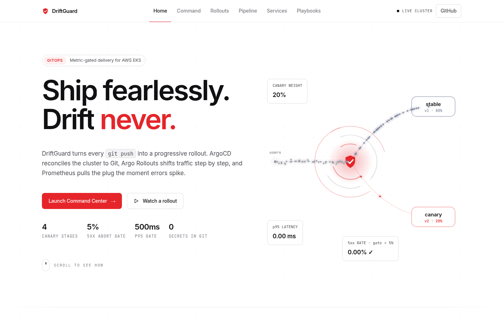

</div>

---

## What it is

DriftGuard is a portfolio-grade delivery platform that shows how production teams release safely on Kubernetes:

- **Terraform** builds the AWS foundation: VPC, EKS, a spot node group, ECR, GitHub OIDC and IRSA.
- **ArgoCD** (app-of-apps) keeps the cluster equal to Git, pruning and **self-healing** any drift.
- **Argo Rollouts** releases `checkout-svc` as a **metric-gated canary** (20 → 40 → 60 → 100%) and `payments-svc` as **blue-green** with a manual promotion gate.
- **Prometheus** feeds `AnalysisTemplate`s that **abort the rollout automatically** if the 5xx ratio goes above 5% or p95 latency goes above 500 ms.
- A **web console** (`apps/frontend`) explains and drives all of it, live against the real services.

No secrets, AWS account IDs or concrete ARNs are committed.

---

## The UI

A zero-build static site (plain HTML/CSS/JS) with a loading screen and six pages. It talks to the real Go services and falls back to a clearly labelled **simulation** when they aren't reachable.

| | |
| --- | --- |
| **Boot screen**: shows the services being probed before the app loads<br><br>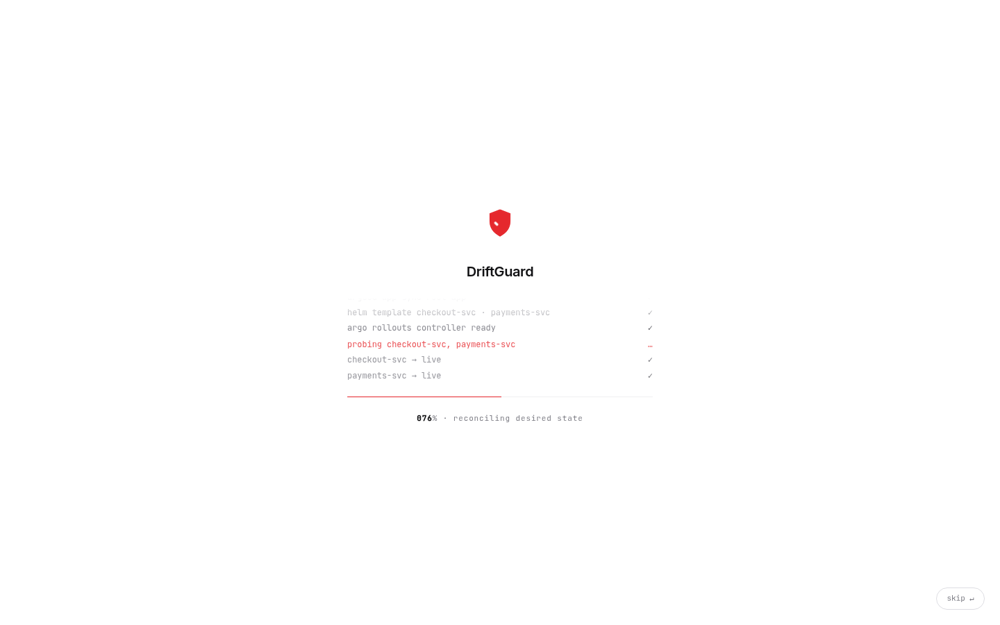 | **How it works**: six-stage delivery flow; the rail fills as you scroll<br><br>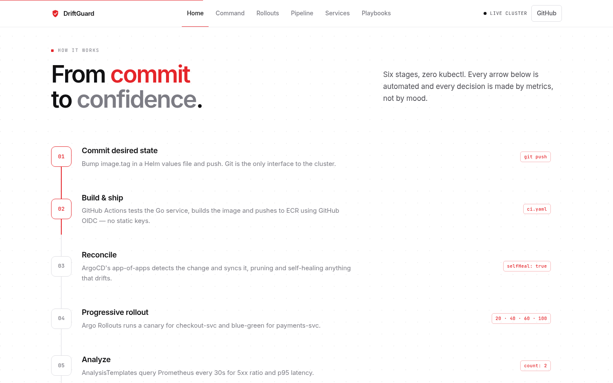 |
| **Capabilities**: animated feature tiles with a live telemetry chart<br><br>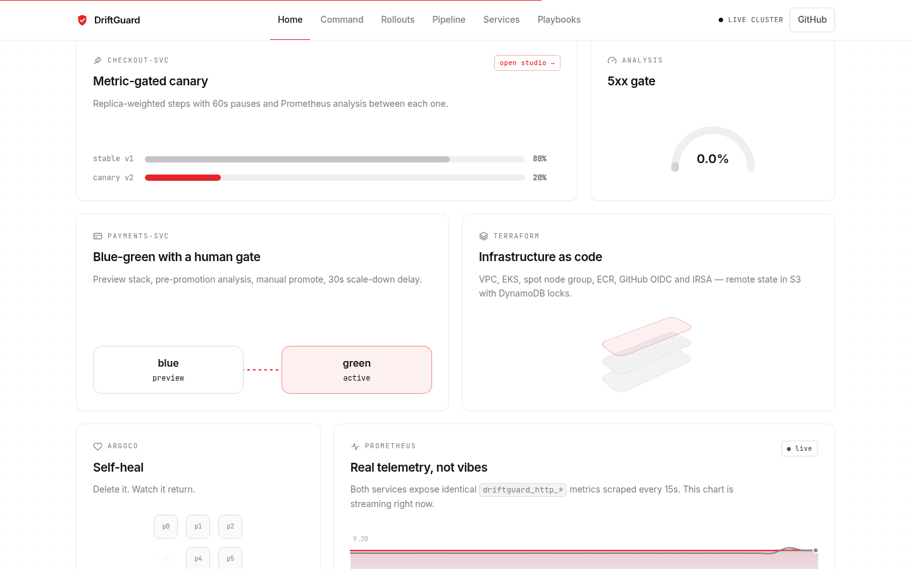 | **Command Center**: live throughput, 5xx rate, p95/p99 latency and rollout state per environment<br><br>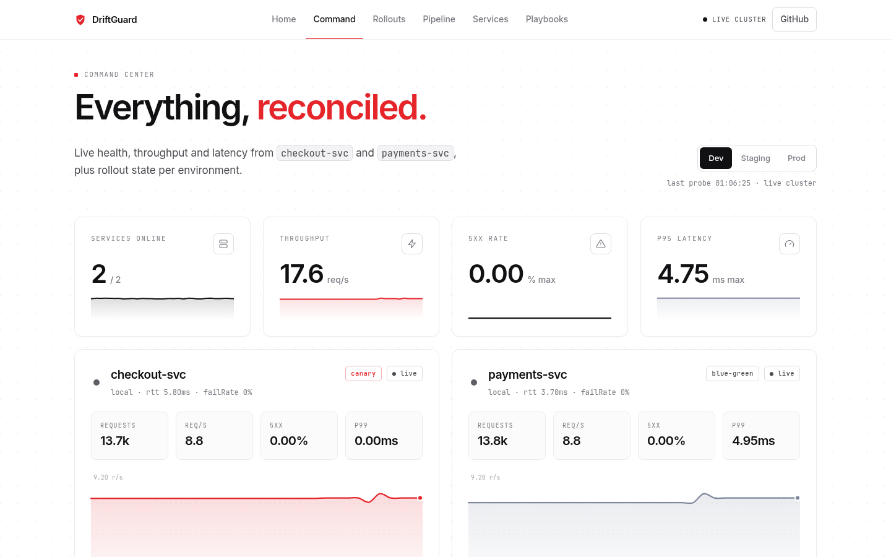 |

### Rollout Studio

Runs the exact strategies from the Helm charts. Toggle `FAIL_RATE=0.5` and the UI calls the **real** service's `/chaos` endpoint. The analysis then reads live Prometheus-style metrics and aborts the canary.

| Canary progressing | Canary aborted by analysis | Blue-green awaiting promotion |
| --- | --- | --- |
| 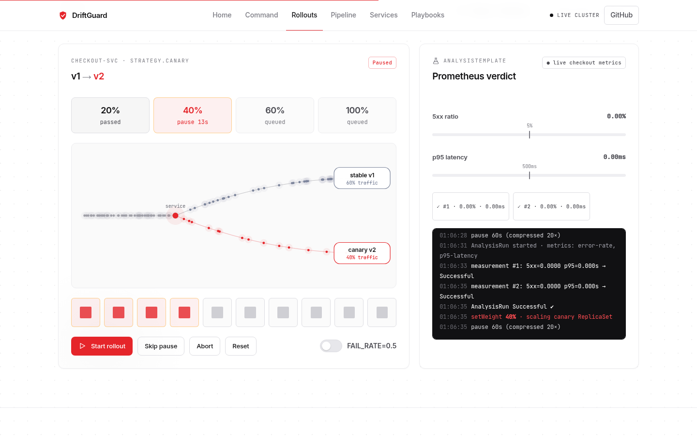 | 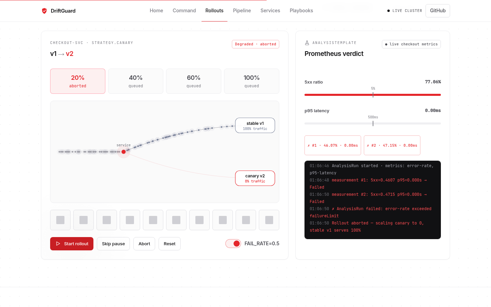 | 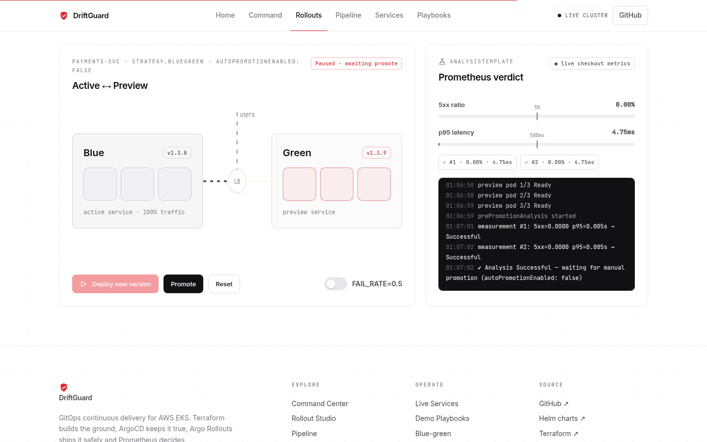 |

### Pipeline, Services and Playbooks

| Pipeline explorer | Live services console | Demo playbooks |
| --- | --- | --- |
| 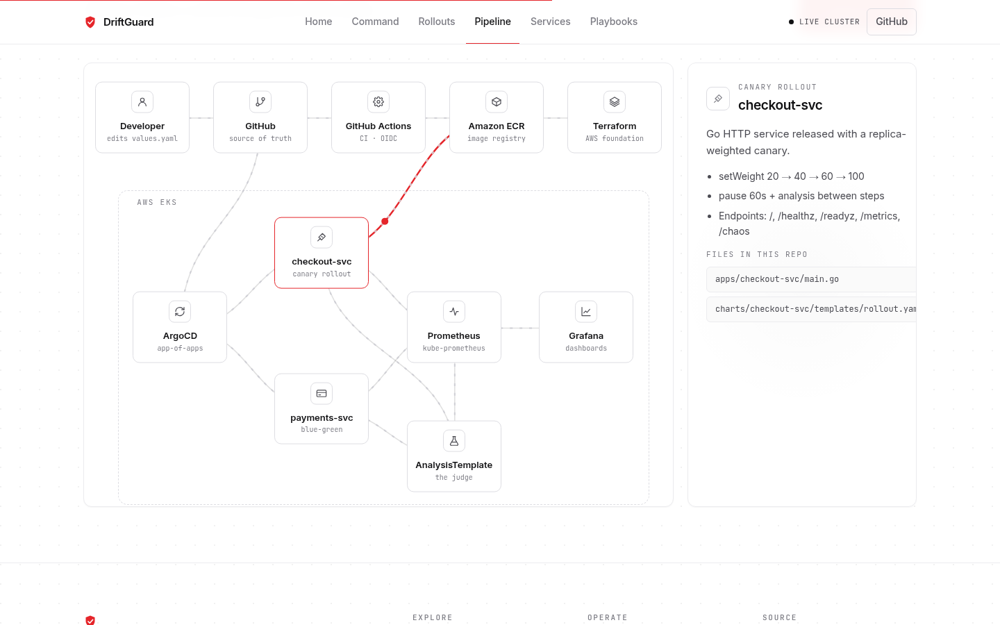 | 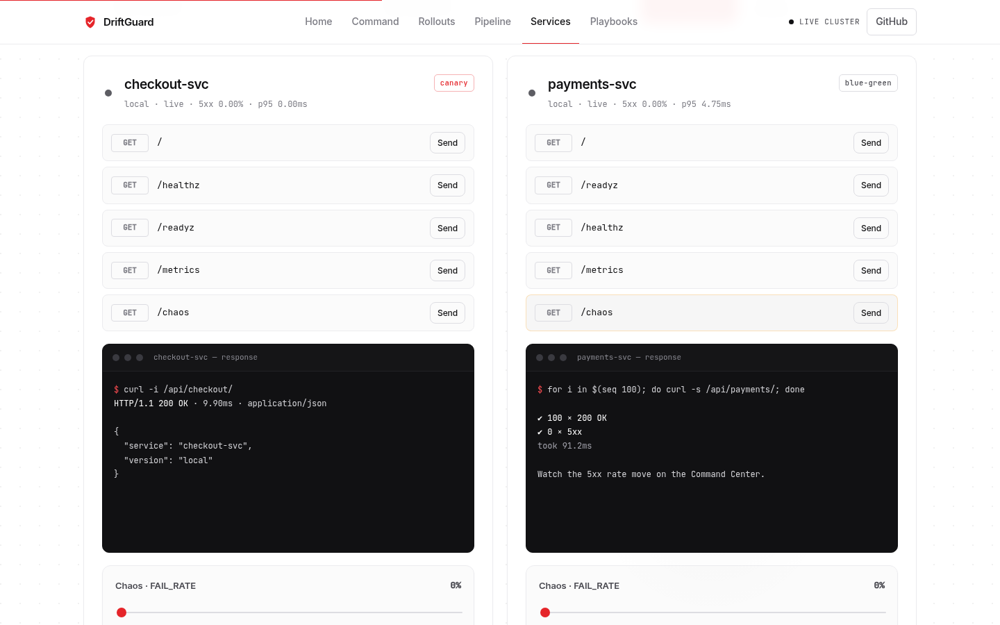 | 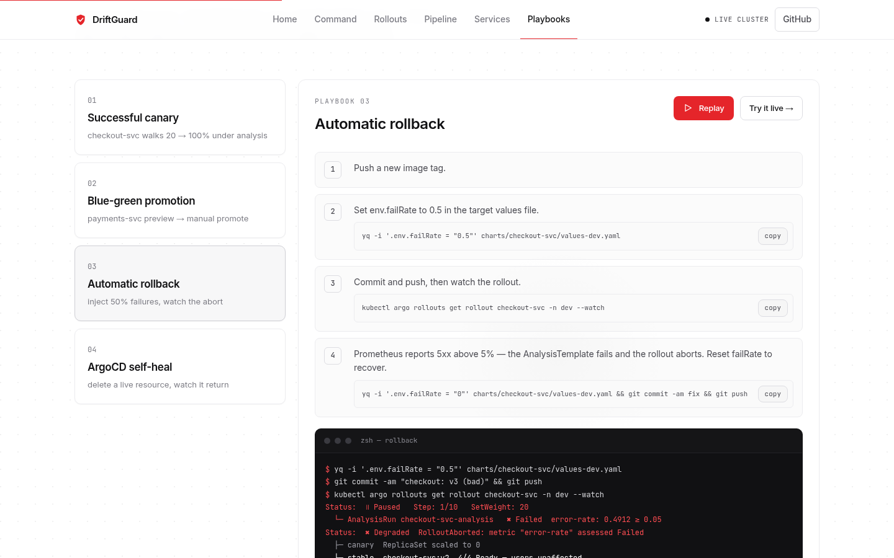 |

- **Pipeline**: click any component to see its role and the repo files that own it; "Follow a commit" animates a change through all ten hops.
- **Services**: call every endpoint, fire 100-request bursts, change the failure rate and browse parsed `/metrics`.
- **Playbooks**: the four demos from [`docs/demos.md`](docs/demos.md), replayed as terminal sessions, with commands you can copy.

<p align="center">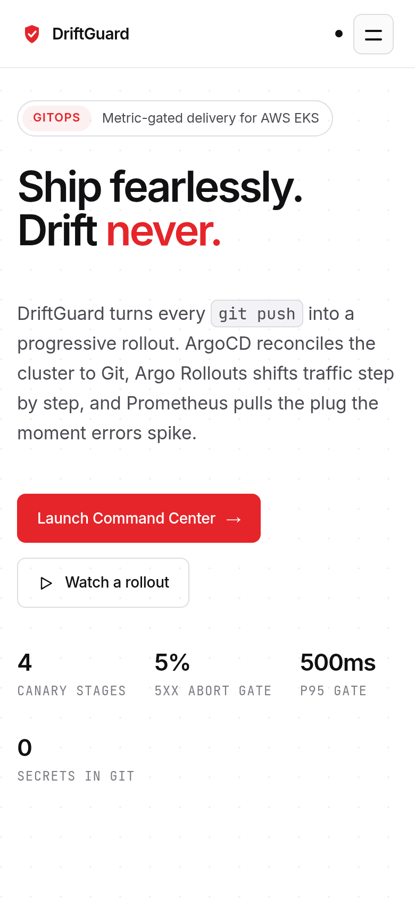</p>

---

## Architecture

### System

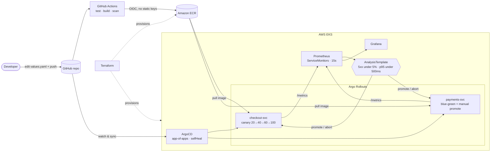

### A release, step by step

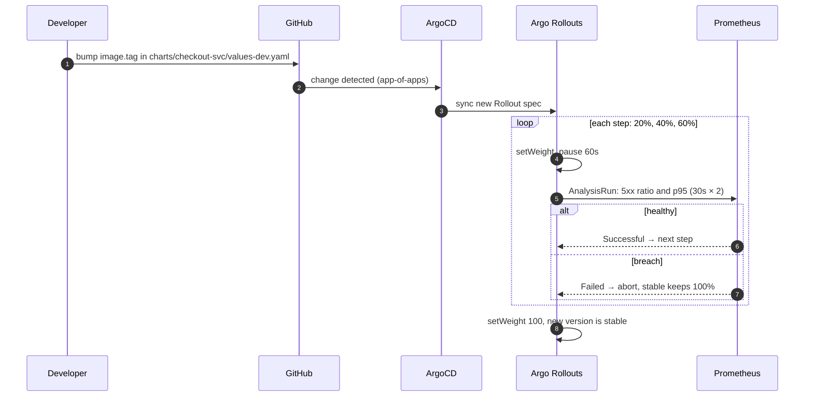

### Layers

| Layer | Owner | What it does | Where |
| --- | --- | --- | --- |
| Infrastructure | Terraform | VPC (1 NAT), EKS, managed node group (`t3.medium` spot in dev), ECR, GitHub OIDC, IRSA, S3 + DynamoDB state | [`terraform/`](terraform) |
| Delivery | ArgoCD | Root app creates a project + one Application per service/env, with `prune` and `selfHeal` | [`argocd/`](argocd) |
| Release | Argo Rollouts | Canary for checkout, blue-green with `prePromotionAnalysis` and `autoPromotionEnabled: false` for payments | [`charts/*/templates/rollout.yaml`](charts) |
| Verification | Prometheus | `driftguard_http_requests_total` and `driftguard_http_request_duration_seconds`, judged by AnalysisTemplates | [`charts/*/templates/analysistemplate.yaml`](charts), [`observability/`](observability) |
| Services | Go | Small HTTP services with health, metrics and a runtime chaos switch | [`apps/checkout-svc`](apps/checkout-svc), [`apps/payments-svc`](apps/payments-svc) |
| Console | Static web app | Explains and drives the platform | [`apps/frontend`](apps/frontend) |

The canary is replica-weighted to keep the demo cheap, without needing an ingress controller or service mesh. For exact traffic splitting in production, pair Argo Rollouts with ALB, NGINX or Istio. More detail is in [`docs/architecture.md`](docs/architecture.md).

### Frontend

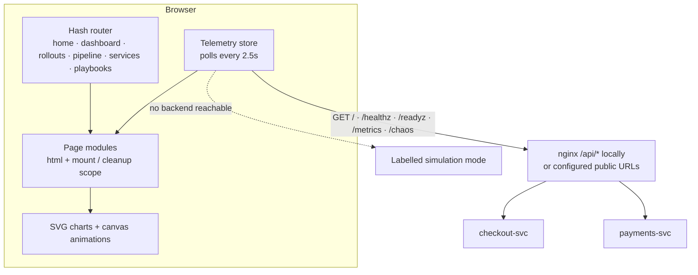

- No build step and no framework: [`index.html`](apps/frontend/index.html), [`styles.css`](apps/frontend/styles.css) and [`app.js`](apps/frontend/app.js).
- Error rate and p95/p99 are computed from **deltas** of the services' Prometheus counters and histogram buckets between polls.
- The base URLs for each service can be changed on the Services page (saved in your browser).

---

## Service API

Both services listen on `:8080` and expose the same surface:

| Endpoint | Description |
| --- | --- |
| `GET /` | `{"service": "...", "version": "..."}`; returns 500 at the configured `FAIL_RATE` |
| `GET /healthz`, `GET /readyz` | Liveness / readiness probes |
| `GET /metrics` | Prometheus metrics |
| `GET /chaos` | Current failure rate |
| `POST /chaos?rate=0.5` | Change the failure rate at runtime (0–1); used by the UI for rollback demos |

CORS is open (`*`) so a separately hosted UI can call them. Environment: `VERSION`, `FAIL_RATE`, `SERVICE_NAME`.

---

## Quick start (local)

Requires Docker.

```bash
make local-up
```

| URL | What |
| --- | --- |
| http://localhost:3000 | DriftGuard UI (live mode) |
| http://localhost:8081 | `checkout-svc` (`/healthz`, `/metrics`, `/chaos`) |
| http://localhost:8082 | `payments-svc` (`/readyz`, `/metrics`, `/chaos`) |

Try a rollback locally: open **Rollouts**, switch on `FAIL_RATE=0.5`, then click **Start rollout**. Or from the shell:

```bash
curl -X POST "http://localhost:8081/chaos?rate=0.5"
```

Stop everything with `make local-down`.

---

## Deploy the UI to Vercel

1. Go to [vercel.com](https://vercel.com), choose **Add New → Project**, and import this repository.
2. Set **Root Directory** to `apps/frontend` and **Framework Preset** to **Other**.
3. Override the build settings: Build Command **empty**, Output Directory **`.`**, Install Command **empty**.
4. Click **Deploy**.

Without public backends, the deployed UI runs in **simulation** mode. To make it live, deploy the two service Dockerfiles anywhere public (Render, Railway, Fly.io…). Then paste their URLs on the **Services** page and click **Save & reconnect**.

---

## Deploy to AWS EKS

Replace these placeholders first:

- `REPLACE_WITH_TERRAFORM_STATE_BUCKET` and `REPLACE_WITH_TERRAFORM_LOCK_TABLE` in [`terraform/backend.tf`](terraform/backend.tf)
- `REPLACE_WITH_ACCOUNT_ID` in the chart values files
- the repository URL in the ArgoCD manifests
- `REPLACE_WITH_TEMPORARY_BOOTSTRAP_PASSWORD` in the observability values

```bash
cd terraform
terraform init
terraform plan  -var-file=environments/dev.tfvars
terraform apply -var-file=environments/dev.tfvars
aws eks update-kubeconfig --name driftguard-dev --region us-east-1
```

Seed the first images:

```bash
aws ecr get-login-password --region us-east-1 \
  | docker login --username AWS --password-stdin <acct>.dkr.ecr.us-east-1.amazonaws.com

docker build -t <acct>.dkr.ecr.us-east-1.amazonaws.com/checkout-svc:v1 apps/checkout-svc
docker push   <acct>.dkr.ecr.us-east-1.amazonaws.com/checkout-svc:v1
docker build -t <acct>.dkr.ecr.us-east-1.amazonaws.com/payments-svc:v1 apps/payments-svc
docker push   <acct>.dkr.ecr.us-east-1.amazonaws.com/payments-svc:v1
```

Install the controllers and hand over to GitOps:

```bash
bash scripts/bootstrap.sh
kubectl apply -f argocd/bootstrap/root-app.yaml
```

Verify:

```bash
kubectl get applications -n argocd
kubectl get rollouts -A
kubectl get servicemonitors -A
```

---

## Demo playbooks

Full steps are in [`docs/demos.md`](docs/demos.md), with helpers in [`scripts/`](scripts) (`make demo-canary`, `demo-bluegreen`, `demo-rollback`, `demo-selfheal`):

1. **Canary promotion**: `checkout-svc` walks 20 → 100% with analysis passing.
2. **Blue-green**: `payments-svc` preview passes analysis, then `kubectl argo rollouts promote`.
3. **Automatic rollback**: set `env.failRate: "0.5"` and watch the AnalysisTemplate abort.
4. **Self-heal**: `kubectl delete service checkout-svc` and ArgoCD restores it from Git.

---

## Repository layout

```
apps/
  checkout-svc/     Go service (canary)
  payments-svc/     Go service (blue-green)
  frontend/         DriftGuard UI: index.html, styles.css, app.js, nginx.conf, vercel.json
charts/             Helm charts: Rollout, Services, AnalysisTemplate, ServiceMonitor
argocd/             bootstrap root app, project, per-env Applications
terraform/          VPC, EKS, ECR, IAM/IRSA, env tfvars
observability/      kube-prometheus-stack values, Grafana dashboard
.github/workflows/  CI (build, scan, push) and Terraform
scripts/            bootstrap, teardown, demo helpers
docs/               architecture, demos, screenshots
```

## Version ledger

All pinned versions and their rationale are in [`VERSIONS.md`](VERSIONS.md).
